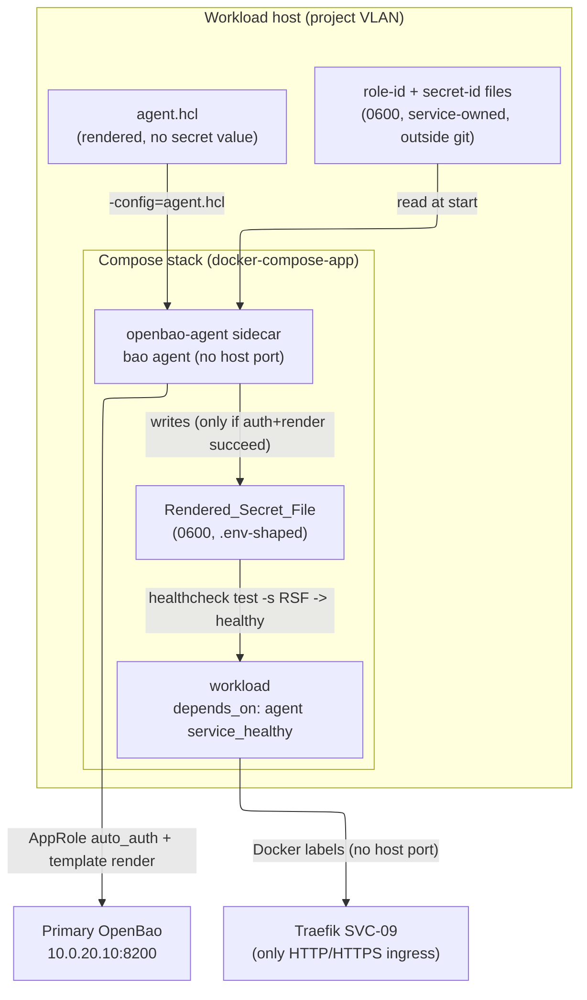

# `openbao-agent` Ansible role

Data-plane role for the **openbao-workload-auth** feature — the downstream half
of the workload→OpenBao authentication path SVC-07's server-side spec
deliberately left out. It runs on the **workload host** (a project VLAN guest),
holds **no admin token**, and stands up the `bao agent` **sidecar** that
authenticates to the Primary via **AppRole** and renders a long-running
workload's secrets into a file the workload reads at container start.

It is the companion of the control-plane
[`openbao_workload_approle`](../openbao_workload_approle/README.md) role, which
runs day-2 against the Primary to enable AppRole, mint the per-project
`<slug>-workload` role, and hand off the `role_id`/`secret_id` over the
sanctioned first-secret channel (a 0600 host file, or a GitLab CI/CD
protected+masked variable — PF FR-8). This role consumes those credentials; it
never mints them and never touches the Primary's config.

## What it does (Task 4)

For `project_slug=<slug>` on the workload host:

1. **Renders `agent.hcl`** (`templates/agent.hcl.j2`) — the `bao agent` config:
   a `vault` block (`address`, conditional `tls_skip_verify`, a `retry` stanza),
   an AppRole `auto_auth` method reading the on-host `role_id`/`secret_id` file
   paths, a token sink, and **one `template` stanza per**
   `openbao_agent_secret_mappings` entry (each reading
   `secret/data/<slug>/<kv_subpath>` into the single Rendered_Secret_File at
   `0600`), with `exit_after_auth = false` (Req 4.1, 4.2, 4.9). The render is
   **idempotent** — a re-run against unchanged config is byte-identical and
   reports `changed=0` (Req 4.6). **No secret value is templated** (Req 4.8).

2. **Builds the `docker-compose-app` variable set with the swap-gate** and
   includes [`docker-compose-app`](../docker-compose-app/README.md) (Req 4.3,
   7.5): the `openbao-agent` sidecar (volumes for `agent.hcl` +
   `role-id`/`secret-id` read-only + the rendered dir; an RSF-presence
   healthcheck; **no published host port**) and the `workload` service (the
   Rendered_Secret_File as an `extra_env_files` entry; `depends_on` the Agent
   `condition: service_healthy`; Traefik labels; the `edge` network; **no
   `ports:`**).

3. **Emits the composition-wiring INFO line** naming `openbao_primary_addr` so
   the real-vs-unavailable decision is visible in run output without reading
   source (Req 7.7, `composition-wiring.md`).

> **Service authors:** the contract for how your Compose workload consumes the
> rendered secrets — the Rendered_Secret_File shape, the `service_healthy` start
> gate, the Traefik-only-no-host-ports ingress rule, and the fail-closed degraded
> mode you will observe — is in
> [`WORKLOAD-CONSUMPTION-CONTRACT.md`](./WORKLOAD-CONSUMPTION-CONTRACT.md)
> (Requirement 5).

## The `agent.hcl` contract — structurally equivalent to the pure renderer

`templates/agent.hcl.j2` is deliberately kept **byte-for-byte equivalent** (after
whitespace normalisation) to the shared pure renderer
[`scripts/installer/workload_auth.py`](../../../scripts/installer/workload_auth.py)`::render_agent_hcl`.
Both are two implementations of one config format, pinned to a single committed
golden file
(`tests/installer/fixtures/openbao_workload_auth/agent.hcl.golden`). The offline
test `tests/installer/test_openbao_agent_template.py` renders the Jinja template
with the same fixture the pure-renderer golden test uses and asserts the two
outputs are identical — so a change to one that is not mirrored in the other
fails offline. If you intentionally change the rendered shape, change **both**
and regenerate the golden.

## The swap-gate — fail-closed by construction

The role builds a `dca_services` list with two services and a start-gate between
them:

- The **`openbao-agent` sidecar** is `healthy` only once a **non-empty**
  Rendered_Secret_File exists (`test -s <RSF>`), with `retries` derived from
  `openbao_agent_render_timeout / openbao_agent_healthcheck_interval` so the
  healthcheck keeps failing until at most the render timeout has elapsed
  (Req 6.5). It publishes **no host port**.
- The **`workload`** service gates its start on `depends_on … openbao-agent:
  { condition: service_healthy }` (Req 5.2, 6.2).

This `depends_on`-on-healthcheck pairing is the **composition-root swap-gate**
(`composition-wiring.md`): real secrets rendered ⇒ Agent healthy ⇒ workload
starts; Primary sealed/unreachable, or the `role_id`/`secret_id` files absent ⇒
**no** Rendered_Secret_File ⇒ Agent never healthy ⇒ workload never starts. **No
canned or empty secret is ever substituted** — the "fake left in production"
guard applied to the secrets path.

### Degraded mode an operator sees (Req 6.6)

- The `workload` container never reaches a healthy state within
  `openbao_agent_render_timeout` seconds of start, and serves no traffic.
- The `openbao-agent` sidecar logs an **authentication failure** (invalid/expired
  Secret_ID) or a **render failure** (Primary sealed) — distinguishable from a
  successful render — and retries auto-auth at an interval not exceeding
  `openbao_agent_retry_interval` seconds, rather than exiting silently
  (Req 6.3, 6.4).

## Runtime contract

This section documents the sidecar's **runtime UID / file-ownership /
writable-path** requirements that this role **already satisfies**. It is a
description of existing behaviour (verified against
[`tasks/main.yml`](./tasks/main.yml)), **not** a behaviour change — its purpose is
so a hand-run or a custom (non-reference) workload reproduces the role's posture
rather than rediscovering it by debugging `permission denied`. Nothing below
loosens a host file permission; the root posture is what makes the 0600 files
readable without doing so.

### 1. The sidecar runs as **root** (`BAO_SKIP_DROP_ROOT=1`) — and why

The `openbao-agent` sidecar service is rendered with
`environment: { BAO_SKIP_DROP_ROOT: "1" }` (see STEP 3 of
[`tasks/main.yml`](./tasks/main.yml), the `dca_services` `openbao-agent` entry).

The `openbao/openbao` image entrypoint normalises `agent -config=...` to a `bao`
subcommand and `su-exec`s it to the **non-root `openbao` user** *unless*
`BAO_SKIP_DROP_ROOT` is set. A dropped-root sidecar cannot read its own
root-owned mounts — `agent.hcl` (0640 `root:root` — carries no secret) and,
critically, the `role_id`/`secret_id` files (**0600 `root:root`**). Those
credential files are **deliberately** 0600 (never world-readable —
`integration-boundaries.md` §2 / `security-standards.md`); loosening them to be
readable by a non-root UID would **widen** secret exposure and is the wrong fix.
Setting `BAO_SKIP_DROP_ROOT=1` matches the Primary's own root posture (it runs
`uid=0` too) and lets the sidecar read the 0600 files **without touching their
host permissions**. This is the image's own documented knob — the
least-surprising mechanism.

### 2. Ownership / mode the cred files and rendered dir must have

The role creates and consumes these paths with a fixed ownership/mode contract
(STEP 1 and STEP 3 of [`tasks/main.yml`](./tasks/main.yml)); a custom workload
must reproduce it:

| Path (by role/variable) | Owner | Mode | How it is mounted | Who writes it |
|---|---|---|---|---|
| `role_id` file (`openbao_agent_role_id_host_path`) | `root:root` | `0600` | read-only (`:ro`) | the control-plane `openbao_workload_approle` role, out of band (the sanctioned first-secret channel) |
| `secret_id` file (`openbao_agent_secret_id_host_path`) | `root:root` | `0600` | read-only (`:ro`) | same as above |
| `agent.hcl` (`openbao_agent_config_host_path`) | `root:root` | `0640` | read-only (`:ro`) | this role (rendered, **no secret value**) |
| rendered-secrets dir (`openbao_agent_host_rendered_dir`) | `root:root` | `0700` | **read-write** (no `:ro`) | the Agent, at container start |
| Rendered_Secret_File (`openbao_agent_rendered_secret_file`) | written by the Agent inside the rendered dir | `0600` | — | the Agent (only after auth+render succeed) |

The decisive points: the credential inputs stay **0600 `root:root`** (not
widened), and the rendered dir is mounted **read-write** so the Agent can write
the Rendered_Secret_File into it. Because the sidecar runs as root (§1), the
0600 inputs are readable and the RSF is written **with no manual `chown` /
permission step** — which is exactly what Requirement 1.6's smoke asserts in
practice.

### 3. The `env_file`-must-exist-before-first-render chicken-and-egg

The Agent renders the Rendered_Secret_File only *after* it auto-auths, so the RSF
**does not exist at `up`-time**. A hard/required `env_file` reference would make
Compose abort at its eager up-front existence check **before** it ever honours
`depends_on: service_healthy`, defeating the swap-gate. The role resolves this
with two cooperating mechanisms (the `openbao_agent_workload_service_wiring`
`set_fact` in [`tasks/main.yml`](./tasks/main.yml)):

- the RSF is layered as a **long-form `extra_env_files` entry with
  `required: false`** (Compose v2.24+), which suppresses *only* the up-front
  existence check; and
- the **`service_healthy` swap-gate** (`depends_on … openbao-agent:
  { condition: service_healthy }` on the Agent's `test -s <RSF>` RSF-presence
  healthcheck) still blocks the workload from starting until the non-empty RSF
  exists.

Fail-closed is therefore preserved: `required: false` removes the *premature*
failure, not the gate. A custom Compose wiring that references the RSF as a
**required** `env_file` would reintroduce the eager-existence-check failure — use
the long-form `required: false` + the `service_healthy` gate instead. For how a
consuming workload layers the RSF, see
[`WORKLOAD-CONSUMPTION-CONTRACT.md`](./WORKLOAD-CONSUMPTION-CONTRACT.md).

### 4. Secrets referenced by path/role only

Everything above names secret-bearing files by **path and role only**; no secret
**value** appears in this document, in `agent.hcl`, or in any task output
(`no_log` is preserved — `openbao_no_log` defaults closed). The `role_id` /
`secret_id` values arrive at runtime over the sanctioned first-secret channel and
the rendered secrets arrive at container start (OpenBao → the Agent); only file
paths and KV references ever appear in the rendered artifacts.

### 5. Optional cred-staging enhancement (NOT NOW)

A future increment *could* have the control-plane
[`openbao_workload_approle`](../openbao_workload_approle/README.md) role stage the
`role_id`/`secret_id` files with an **agent-friendly owner/mode** (e.g. a
dedicated non-root service UID) so the sidecar need not run as root. This is an
**optional enhancement recorded for a later increment — not implemented here**.
It is explicitly unnecessary today: the root posture (§1) already makes the 0600
`root:root` files readable without widening them, so the runtime contract is
satisfied by **this documentation plus the role's existing behaviour**, with no
code change required.

> **Dev issuer reachability (§D) — see the consumer journey.** A workload whose
> server side validates ZITADEL tokens also needs to *reach and trust* the issuer
> from inside its container in dev. That dev-only recipe (a Compose `extra_hosts`
> alias to the Traefik ingress + the self-signed posture) lives in the
> [SSO consumption: dev issuer-reachability recipe (§D)](../../../docs/CONSUMER-JOURNEY.md#sso-consumption-dev-issuer-reachability-recipe-d)
> section of the consumer journey runbook; it is a distinct concern from the
> agent runtime contract above.

## Role layout

```
openbao-agent/
  defaults/main.yml        # primary addr/TLS, agent image, cred/sink/config paths, secret mappings, retry/render-timeout, workload image/labels
  tasks/main.yml           # STEP 1 validate+dirs -> STEP 2 render agent.hcl -> STEP 3 swap-gate dca_services + include docker-compose-app -> STEP 4 INFO line
  templates/agent.hcl.j2   # the bao agent config (structurally equivalent to render_agent_hcl)
  handlers/main.yml        # empty skeleton
  meta/main.yml
  README.md
```

## Key variables

See [`defaults/main.yml`](./defaults/main.yml) for the full set. Highlights:

| Variable | Default | Purpose |
|---|---|---|
| `project_slug` | *(required)* | The project whose KV subtree (`secret/data/<slug>/...`) the Agent reads. |
| `workload_image` | *(required)* | The workload container image the sidecar renders secrets for. |
| `openbao_primary_addr` | `https://10.0.20.10:8200` | Primary API address the Agent auto-auths to (Req 4.4). |
| `openbao_primary_tls_skip_verify` | `{{ openbao_tls_self_signed | default(false) | bool }}` | Render `tls_skip_verify` in `agent.hcl` for the self-signed mock cert (Req 4.5). |
| `openbao_agent_image` | `openbao/openbao:2.4` | Image for the `bao agent` sidecar (pinned, matches the server line). |
| `openbao_agent_secret_mappings` | `[]` *(required non-empty)* | List of `{kv_subpath, kv_field, env_key}`; one `template` stanza each (Req 4.2). |
| `openbao_agent_role_id_host_path` | `/etc/openbao-workload/<slug>/<slug>-workload-role-id` | Host path of the 0600 role-id file (mounted read-only). |
| `openbao_agent_secret_id_host_path` | `/etc/openbao-workload/<slug>/<slug>-workload-secret-id` | Host path of the 0600 secret-id file (mounted read-only). |
| `openbao_agent_stack_dir` | `{{ dca_stack_dir \| default((dca_base_dir \| default('/opt/compose')) ~ '/' ~ dca_app_name) }}` | Compose stack dir this role writes `agent.hcl` + the rendered dir into and that `docker-compose-app` then mounts. Mirrors `docker-compose-app`'s own `dca_stack_dir` default **exactly** so both compute the same path — this role cannot read `docker-compose-app`'s internal `dca_stack_dir` in its own defaults/tasks (they run before that role is included). |
| `openbao_agent_rendered_secret_file` | `/openbao/agent/rendered/secrets.env` | The Rendered_Secret_File (0600) the workload reads (Req 4.9). |
| `openbao_agent_num_retries` | `0` | `vault.retry.num_retries` (0 = retry indefinitely) (Req 6.3). |
| `openbao_agent_retry_interval` | `30` | Max seconds between auto-auth retries (Req 6.3). |
| `openbao_agent_render_timeout` | `120` | Seconds before the absent-RSF workload is deemed non-healthy; drives the healthcheck retries (Req 6.5). |
| `openbao_agent_workload_host_rule` | `<slug>-workload.example.test` | Traefik router Host rule (placeholder; override per project) (Req 5.4). |
| `openbao_dev_expose_secrets` | `false` | Dev-only opt-in; flips `no_log` off for a single run (same semantics as the control role). |
| `openbao_no_log` | `{{ not (openbao_dev_expose_secrets | bool) }}` | Resolved `no_log` value for secret-bearing tasks. |

**No secret value lives in this role.** The `role_id`/`secret_id` arrive at
runtime (0600 host files from the control role) and the rendered secrets arrive
at container start (OpenBao → the Agent); only file paths and KV references ever
appear in the rendered artifacts.

## Topology & swap-gate



## Verify the role (offline, Tier-1)

Lint the role's YAML + Ansible structure, and validate the rendered Compose
stack. The `agent.hcl` golden cross-check lives in
`tests/installer/test_openbao_agent_template.py` (run via the project venv
pytest). Invoke venv binaries by absolute path per `dev-workflow.md`.

<!-- doctest: offline -->
<!-- cwd: ansible -->
```bash
~/venv/devinfra/bin/ansible-lint roles/openbao-agent
```

<!-- doctest: offline -->
<!-- cwd: ansible -->
```bash
~/venv/devinfra/bin/yamllint roles/openbao-agent
```

<!-- doctest: offline -->
<!-- cwd: . -->
```bash
~/venv/devinfra/bin/pytest tests/installer/test_openbao_agent_template.py -q
```

## Live verification (requires-infra) — the self-signed mock-cert Primary

The live login/render acceptance for this role runs against a real SVC-07 Primary
via `tests/installer/test_workload_auth_integration.py` and the provision-then-test
walkthrough in
[`infra/projects/svc-07-secrets-manager/INSTALL-RUNBOOK.md`](../../../infra/projects/svc-07-secrets-manager/INSTALL-RUNBOOK.md)
§6 (gated on `AGENT_LIVE_AUTHORIZED` + the throwaway guard; never CI/acc/prod).

The homelab Primary serves the **self-signed mock cert**
(`openbao_tls_self_signed=true`, no SVC-08/EJBCA). This role derives
`openbao_primary_tls_skip_verify` from `openbao_tls_self_signed` (default
**false**), so a live run against a mock-cert Primary **must** set
`openbao_tls_self_signed=true` or the Agent's AppRole auto-auth fails
`x509: certificate signed by unknown authority`. The runbook's manual role runs
pass `-e openbao_tls_self_signed=true`; the integration harness threads it into
every role run by default (`_DEFAULT_ROLE_EXTRA_VARS`), overridable per-test for a
real-EJBCA-cert Primary. The production default stays `false` — the skip is a
dev/mock affordance only.
