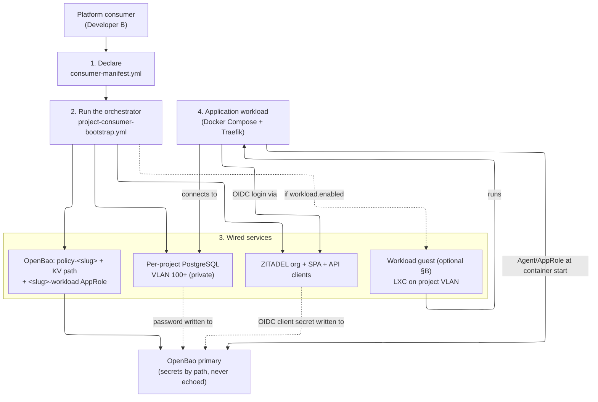
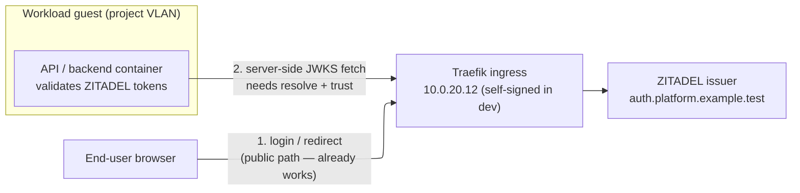

# Consumer Journey Runbook — from a declared manifest to a wired application

This runbook walks the **end-to-end application-onboarding journey**: declare a
Consumer_Manifest, run the one orchestrator, obtain a wired database + SSO +
secrets, and have the application's workload consume them. It is **distinct from
the per-service install runbooks** — those (e.g.
[`infra/projects/<slug>/INSTALL-RUNBOOK.md`](../infra/projects/dronefleet/INSTALL-RUNBOOK.md))
cover standing up one service from nothing and testing it; this runbook is the
consumer's story across all the services a project consumes at once.

- **Spec:** [`.kiro/specs/project-consumer-onboarding/`](../.kiro/specs/project-consumer-onboarding/)
- **ADRs:** [ADR-0019](../.kiro/decisions/0019-per-project-svc01-consumer-root-pattern.md), [ADR-0020](../.kiro/decisions/0020-manifest-driven-consumer-onboarding-orchestrator.md)
- **Manifest reference:** [`CONSUMER-MANIFEST-REFERENCE.md`](CONSUMER-MANIFEST-REFERENCE.md)

> **Placeholders only.** No example below contains a real credential or
> hostname. The DB password and the OIDC client secret are **OpenBao-mediated**:
> generated at provision, written to OpenBao under the project's path, and
> **never echoed** to stdout or committed. The application fetches them at
> container-start via its own OpenBao Agent/AppRole — never from a repo.

> **Doctest tiers.** Offline preflight carries `<!-- doctest: offline -->`;
> provisioning/bootstrap/test commands carry `<!-- doctest: requires-infra -->`
> (they need a live cluster). Tier rules:
> [`documentation-testing.md`](../.kiro/steering/documentation-testing.md).

---

## The journey at a glance



---

## Step 1 — Declare the Consumer_Manifest

A project declares the catalog services it consumes in one per-project file,
`infra/projects/<slug>/consumer-manifest.yml`. The full field schema and the
enumerated consumable set (`database` / `sso` / `secrets` / the optional
`workload` guest) are in the
[manifest-format reference](CONSUMER-MANIFEST-REFERENCE.md). All service blocks
are optional; only `slug` is mandatory. `vlan_id` is **never** declared here — it
is resolved from the Registry (Req 2.3).

```yaml
# infra/projects/<slug>/consumer-manifest.yml  (placeholders only)
slug: <slug>

database:
  db_name: <slug>
  db_role: <slug>_app
  engine: postgres        # postgres (default) | mariadb
  tier: small             # small | medium

sso:
  org_name: proj-<slug>
  app_registrations:
    - name: <slug>-spa
      app_type: public-spa
      auth_method: none
      redirect_uris: ["https://<slug>.<platform-domain>/oauth/callback"]
    - name: <slug>-api
      app_type: api
      auth_method: jwt-profile

secrets:
  policy: policy-<slug>
  path: secret/data/<slug>
  workload_token_ttl: 3600
  workload_token_max_ttl: 14400
  secret_id_ttl: 86400
  secret_id_num_uses: 0

workload:                 # OPTIONAL — provision a guest to run the app on (§B)
  enabled: true           # false/absent (default) => no guest, strict no-op
  tier: small             # small (default) | medium
  count: 1                # >=1 (default 1); >1 reserved for a later increment
```

Validate it offline before any mutation (fails naming the first offending field):

<!-- doctest: offline -->
<!-- cwd: . -->
```bash
~/venv/devinfra/bin/python scripts/installer/consumer_manifest.py \
  --check infra/projects/dronefleet/consumer-manifest.yml
```

> **Prerequisite:** the slug must already be in the Registry
> ([`infra/platform-foundation/projects.yaml`](../infra/platform-foundation/projects.yaml))
> and its host-index ledger row present. Onboard the slug via the onboarding
> script + MR flow first; the orchestrator halts at preflight if the slug is
> absent, directing you there (Req 2.2).

---

## Step 2 — Run the orchestrator (one Ansible command)

One sanctioned entry point performs the declared onboarding under the 4-phase
installer contract, **composing** the existing per-service onboarders (it never
reimplements them). `project_slug` is the only identity you pass; `vlan_id` is
resolved from the Registry.

<!-- doctest: requires-infra -->
<!-- cwd: . -->
```bash
~/venv/devinfra/bin/ansible-playbook -i ansible/inventory/localhost.yml \
  ansible/playbooks/project-consumer-bootstrap.yml \
  -e cluster_env_file=cluster.dev.env \
  -e project_slug=dronefleet \
  -e svc01_vmid=1101
```

The four phases:

1. **Preflight (fail-closed gate)** — validate the manifest, resolve the VLAN
   from the Registry, and bounded-probe the declared dependencies (OpenBao
   unsealed, ZITADEL reachable). A failure here provisions nothing.
2. **Provision** — apply the per-project SVC01_Consumer_Root (`db/` root) on the
   project VLAN and configure PostgreSQL via the `postgres-server` role.
3. **Bootstrap** — compose the onboarders: the DB + least-priv app role (password
   → OpenBao), the OpenBao isolation triple + `<slug>-workload` AppRole, and the
   ZITADEL org + SPA/API clients (OIDC client secret → OpenBao).
4. **Health / handoff** — bounded health polls, then a completion summary naming
   the DB endpoint, SSO app IDs, and the OpenBao path + workload AppRole — secrets
   **by name/path only, never by value**.

**Re-runs are safe** (Req 6): a converged re-run reports zero changes; a re-run
after a partial failure completes only the remainder.

**Degraded mode** (Req 9): if OpenBao is sealed, ZITADEL is down, or the DB guest
is unreachable, the run halts non-zero naming the dependency with no partial
wiring. Bring the dependency back **only** via its own `svc-NN-bootstrap.yml`
automated path, then re-run.

---

## Step 3 — What you get (wired services)

| Service | What the orchestrator wired | Where the secret lives |
|---|---|---|
| **Database** (SVC-01) | per-project PostgreSQL on VLAN 100+, DB + least-priv app role | source record at `secret/proj-<slug>/postgres`; bridged for the workload to `secret/data/<slug>/db` (field `database_url`, env `DATABASE_URL`) — see the [workload-readable DB path](CONSUMER-MANIFEST-REFERENCE.md#workload-readable-db-credential-path-authoritative) |
| **SSO** (SVC-06) | ZITADEL org + a public SPA client + an API client | OIDC client secret at `secret/proj-<slug>/zitadel/...` in OpenBao |
| **Secrets** (SVC-07) | `policy-<slug>` + KV path + `<slug>-workload` AppRole (renewable TTL) | AppRole `role_id`/`secret_id` handed off per PF FR-8 |

Nothing in this table is ever echoed to stdout or committed — the completion
summary names each by **path**, never by value.

---

## Step 4 — The application workload consumes them

The application deploys as a Docker Compose stack, reverse-proxied by Traefik
(no directly-exposed host port for HTTP/HTTPS). At container start its **OpenBao
Agent** authenticates with the `<slug>-workload` AppRole and renders the DB
credential and OIDC client secret into the workload's environment — the day-2
secrets-retrieval path (`integration-boundaries.md` §2). The DB credential is read
from the agreed **workload-readable path** `secret/data/<slug>/db` (field
`database_url`, surfaced as `DATABASE_URL`); the authoritative definition of that
path lives in the
[Consumer_Manifest reference](CONSUMER-MANIFEST-REFERENCE.md#workload-readable-db-credential-path-authoritative).
The application then:

- connects to its private per-project PostgreSQL on the project VLAN;
- performs OIDC login against its ZITADEL SPA/API clients;
- reads any other project secrets from its OpenBao KV path.

The workload never holds a plaintext secret in a repo and never reaches another
project's VLAN — cross-project data flow, if ever needed, goes only via a
shared-services-VLAN service (`integration-boundaries.md` §6).

---

## The last mile — where your workload runs (§B)

A consumer run reporting `failed=0` means **onboarded**, not yet **deployable**:
the database, SSO, and secrets are wired, but a workload still needs a host to
run on. This is the *last mile*. The **definition-of-done** is a reference
*hello-workload*: the Agent sidecar renders `DATABASE_URL` from the
Agent-rendered Rendered_Secret_File, the workload container starts only after the
sidecar is healthy (the `depends_on … service_healthy` swap-gate), and the
workload reports a `/healthz` **200** through Traefik-only ingress. A green
`/healthz` is the single "hello-workload healthy" signal that the project is
deployable.

Stand it up and prove it end-to-end — including the **fail-closed** half (Primary
sealed ⇒ no secret ⇒ workload never starts) — with the tier-annotated
provision-then-test walkthrough in the per-project install runbook
([`infra/projects/<slug>/INSTALL-RUNBOOK.md` Part 5](../infra/projects/dronefleet/INSTALL-RUNBOOK.md#part-5--hello-workload-the-last-mile-definition-of-done-tier-2-requires-infra));
this runbook cross-references it rather than restating it. A workload that
validates ZITADEL tokens also needs the dev issuer-reachability recipe in the
[SSO section below](#sso-consumption-dev-issuer-reachability-recipe-d).

### Where the workload runs — supported topologies (Req 2.6)

Three topologies are supported. All three stand the reference workload up via the
same existing `openbao-agent` role (no new agent wiring) and share the same
runtime prerequisites below.

**1. Dedicated workload guest (`workload.enabled: true`).** Declare the optional
[`workload` block](CONSUMER-MANIFEST-REFERENCE.md#workload-block) in the manifest.
The consumer flow provisions a dedicated LXC on the **project VLAN** (100+),
within the project's own per-project Terraform root/state, with its `host_index`
read from the host-index ledger (ADR-0015) and its IP computed via the NET-00
formula — never hand-chosen. Its hostname is the ADR-0021 role-code form
`workload-<vlan_id>-<instance>` (e.g. `workload-100-01`). `terraform destroy` /
the project clean-slate tears it down with the rest of the project (no orphan,
one-state-per-project — Req 2.5). This is the topology the Part-5 walkthrough
exercises.

**2. Co-locate on the DB guest.** If you onboarded **without** a `workload` block,
run the reference workload on the existing per-project DB guest by pointing the
stand-up play at the consumer inventory and overriding the target group — no
dedicated guest is provisioned:

<!-- doctest: requires-infra -->
<!-- cwd: . -->
```bash
~/venv/devinfra/bin/ansible-playbook \
  -i ansible/inventory/dronefleet-consumer.generated.yml \
  ansible/playbooks/hello-workload-deploy.yml \
  -e project_slug=dronefleet -e hello_workload_target=postgres
```

**3. Bring-your-own host.** Run the workload on a host you manage yourself
(outside the consumer flow's provisioning). You take responsibility for placing
the host on the project VLAN and for the runtime prerequisites below; point the
stand-up play at that host/group via `-e hello_workload_target=<group-or-host>`.

### Runtime prerequisites the `openbao-agent` role assumes

Whichever topology you choose, the host the workload runs on must satisfy the
prerequisites the `openbao-agent` role (and the swap-gate) depend on:

- **Docker + Compose present.** The workload is a Docker Compose stack (agent
  sidecar + app container). A dedicated workload guest (topology 1) and the DB
  guest (topology 2) get Docker CE + the Compose plugin from the `common` role
  (ADR-0003); a bring-your-own host (topology 3) must provide them itself.
- **Reachability to the OpenBao Primary `10.0.20.10`.** The Agent sidecar logs in
  with the `<slug>-workload` AppRole and renders the secret from the Primary at
  container start; the host must reach it on the shared-services VLAN via the
  ADR-0004 host gateway.
- **Reachability to Traefik `10.0.20.12`.** HTTP/HTTPS ingress is **Traefik-only**
  via a Docker `Host()` label and the ADR-0018 cross-guest file-provider route —
  **never a host port** (`integration-boundaries.md` §1). A workload that
  validates ZITADEL tokens additionally needs the dev issuer-reachability recipe
  ([SSO section below](#sso-consumption-dev-issuer-reachability-recipe-d)) so its
  server-side JWKS fetch can reach + trust the issuer through Traefik.

If the Primary is sealed or unreachable, the Agent never renders the
Rendered_Secret_File, the sidecar never becomes healthy, and the workload never
starts — the fail-closed swap-gate the Part-5 walkthrough asserts explicitly.

---

## SSO consumption: dev issuer-reachability recipe (§D)

A workload that validates ZITADEL tokens has **two independent** issuer-
reachability problems, and solving one does not solve the other:

1. **Browser → issuer.** The end user's browser must reach the ZITADEL login
   page and the OIDC authorize/redirect endpoints. This is the public,
   LAN/Traefik-facing path you already get from the SPA client's `redirect_uris`
   and the shared Traefik ingress — nothing extra is needed for it.
2. **API container → issuer (server side).** The workload's **backend/API
   container** must reach the issuer host *from inside the container* to fetch
   the OIDC discovery document and the **JWKS** (the signing keys it validates
   access tokens against). This is a separate concern: it is a server-to-server
   call made by the container's runtime, not the browser, and it must both
   **resolve** the issuer hostname and **trust** the TLS certificate the issuer
   presents.

"Issuer reachable from the browser" is NOT the same as "issuer reachable **and
trusted** from the API container." A backend that logs in fine in a browser can
still fail at boot — or on the first token validation — with a DNS-resolution
error or an `x509: certificate signed by unknown authority` from the JWKS fetch,
because the container half of the problem was never addressed. The recipe below
addresses exactly that container half, **in dev only**.

> **Dev-only — mirrors the platform opt-in philosophy.** Everything in this
> section is a **development affordance that is OFF by default** and MUST NEVER
> be used in acceptance or production. It is the issuer-reachability sibling of
> the `openbao_dev_expose_secrets` opt-in and the SVC-07/09 self-signed mock
> posture (ADR-0013/0014): a conscious, per-deployment dev choice that never
> silently weakens the production posture. The **production** posture needs none
> of it — see [Production posture](#production-posture-the-non-dev-path) below.

### Why the container cannot reach the issuer in dev

In dev there is no public DNS for the platform domain and the issuer is served
behind Traefik with a **self-signed** certificate (SVC-09's
`traefik_tls_self_signed` mock / the SVC-07 self-signed Primary posture — no
SVC-08/EJBCA CA yet). So from inside the API container:

- the issuer hostname (placeholder `auth.platform.example.test`) **does not
  resolve** — there is no DNS record for it on the project VLAN; and
- even once it resolves, the self-signed cert is **not trusted** by the
  container's default CA bundle, so the server-side JWKS fetch fails TLS
  verification.



### The recipe (dev-only)

Two cooperating pieces on the API container, both scoped to the dev deployment:

1. **Resolve the issuer host to the Traefik ingress IP** with a Compose
   `extra_hosts` alias. This adds an `/etc/hosts` entry inside the container so
   the issuer hostname resolves to Traefik (`10.0.20.12` per ADR-0004), which
   terminates TLS and routes to ZITADEL. This is the server-side analogue of the
   browser's DNS — the container gets no platform DNS otherwise.

2. **Tolerate the self-signed cert for the JWKS fetch.** Because dev serves a
   self-signed cert, the backend's OIDC/JWKS client must either trust that
   specific cert or (dev-only) skip verification — exactly the posture the
   OpenBao Agent already uses for its own dev login
   (`openbao_primary_tls_skip_verify` derived from `openbao_tls_self_signed`, see
   the [`openbao-agent` role README](../ansible/roles/openbao-agent/README.md#live-verification-requires-infra--the-self-signed-mock-cert-primary)).
   How you express "trust self-signed" is backend-specific (an OIDC-library flag,
   or mounting the self-signed CA into the container's trust store); the key
   point is it is a **dev-only switch**, never a committed production default.

The `extra_hosts` alias is an **illustrative Compose fragment** — a dev overlay
on the workload service, not a runnable command (shown as a plain YAML fragment,
no doctest tier — it is display-only like the manifest examples above):

```yaml
# DEV ONLY — never in acceptance/production. Placeholders only.
# Overlay on the workload (API) service in the dev Compose for the project.
services:
  workload:
    extra_hosts:
      # Resolve the ZITADEL issuer host to the Traefik ingress IP so the
      # API container's server-side JWKS/discovery fetch can reach it.
      - "auth.platform.example.test:10.0.20.12"
    environment:
      # Dev-only: let the backend's OIDC/JWKS client tolerate the self-signed
      # cert Traefik presents in dev. Backend-specific flag name; shown as a
      # placeholder. NEVER set in acceptance/production.
      - OIDC_ISSUER=https://auth.platform.example.test
      - OIDC_TLS_SKIP_VERIFY=true   # dev-only opt-in; default false
```

The reference hello-workload (see the per-project install runbook
[`infra/projects/<slug>/INSTALL-RUNBOOK.md`](../infra/projects/dronefleet/INSTALL-RUNBOOK.md))
demonstrates this overlay when it includes an SSO-consuming component, so a
consumer can copy it verbatim and substitute the real issuer host.

### Production posture (the non-dev path)

In acceptance and production the recipe is **not used and not needed**:

- the issuer is served behind Traefik with a certificate from a **trusted CA**
  (SVC-08/EJBCA issuing an internal CA, or an ACME/Let's Encrypt cert —
  `security-standards.md` "TLS and transport security"), so the API container's
  default CA bundle already trusts it — **no `OIDC_TLS_SKIP_VERIFY`, no mounted
  self-signed CA**; and
- the issuer hostname resolves through normal DNS, so **no `extra_hosts`
  alias** is required.

The dev `extra_hosts`/skip-verify switches MUST therefore be absent (or forced
off) in any non-dev deployment. Treating the self-signed/skip-verify path as
dev-only is the same discipline the rest of the platform applies to its mocks
and secret-exposure opt-ins: a reviewable knob whose default keeps the
production posture intact.

---

## Reset

To return a mis-onboarded project to a clean baseline before re-onboarding, use
the clean-slate reset documented in the per-project install runbook
([`infra/projects/<slug>/INSTALL-RUNBOOK.md` Part 4](../infra/projects/dronefleet/INSTALL-RUNBOOK.md#part-4--clean-slate-teardown-tier-2-requires-infra)).
It tears the consumer resources to baseline but **preserves** the Registry entry
and the `<slug>-infra` network slice (Req 7.7).
