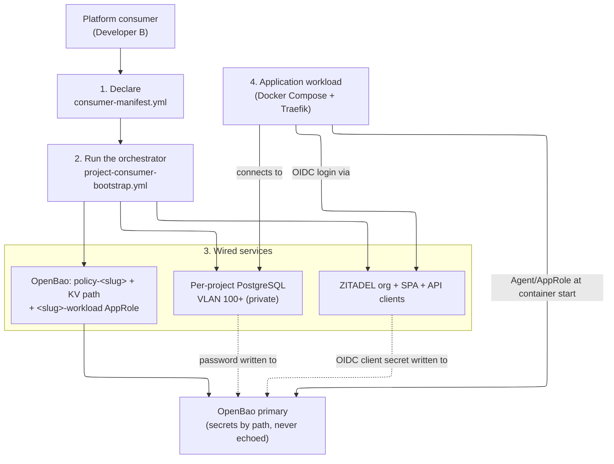

# Consumer Journey Runbook — from a declared manifest to a wired application

This runbook walks the **end-to-end application-onboarding journey**: declare a
Consumer_Manifest, run the one orchestrator, obtain a wired database + SSO +
secrets, and have the application's workload consume them. It is **distinct from
the per-service install runbooks** — those (e.g.
[`infra/projects/<slug>/INSTALL-RUNBOOK.md`](../infra/projects/dronefleet/INSTALL-RUNBOOK.md))
cover standing up one service from nothing and testing it; this runbook is the
consumer's story across all the services a project consumes at once.

- **Spec:** [`.kiro/specs/project-consumer-onboarding/`](../.kiro/specs/project-consumer-onboarding/)
- **ADRs:** [ADR-0019](../.kiro/decisions/0019-per-project-svc01-consumer-root-pattern.md), [ADR-0020](../.kiro/decisions/0020-manifest-driven-consumer-onboarding-orchestrator.md)
- **Manifest reference:** [`CONSUMER-MANIFEST-REFERENCE.md`](CONSUMER-MANIFEST-REFERENCE.md)

> **Placeholders only.** No example below contains a real credential or
> hostname. The DB password and the OIDC client secret are **OpenBao-mediated**:
> generated at provision, written to OpenBao under the project's path, and
> **never echoed** to stdout or committed. The application fetches them at
> container-start via its own OpenBao Agent/AppRole — never from a repo.

> **Doctest tiers.** Offline preflight carries `<!-- doctest: offline -->`;
> provisioning/bootstrap/test commands carry `<!-- doctest: requires-infra -->`
> (they need a live cluster). Tier rules:
> [`documentation-testing.md`](../.kiro/steering/documentation-testing.md).

---

## The journey at a glance



---

## Step 1 — Declare the Consumer_Manifest

A project declares the catalog services it consumes in one per-project file,
`infra/projects/<slug>/consumer-manifest.yml`. The full field schema and the
enumerated consumable set (`database` / `sso` / `secrets`) are in the
[manifest-format reference](CONSUMER-MANIFEST-REFERENCE.md). All service blocks
are optional; only `slug` is mandatory. `vlan_id` is **never** declared here — it
is resolved from the Registry (Req 2.3).

```yaml
# infra/projects/<slug>/consumer-manifest.yml  (placeholders only)
slug: <slug>

database:
  db_name: <slug>
  db_role: <slug>_app
  engine: postgres        # postgres (default) | mariadb
  tier: small             # small | medium

sso:
  org_name: proj-<slug>
  app_registrations:
    - name: <slug>-spa
      app_type: public-spa
      auth_method: none
      redirect_uris: ["https://<slug>.<platform-domain>/oauth/callback"]
    - name: <slug>-api
      app_type: api
      auth_method: jwt-profile

secrets:
  policy: policy-<slug>
  path: secret/data/<slug>
  workload_token_ttl: 3600
  workload_token_max_ttl: 14400
  secret_id_ttl: 86400
  secret_id_num_uses: 0
```

Validate it offline before any mutation (fails naming the first offending field):

<!-- doctest: offline -->
<!-- cwd: . -->
```bash
~/venv/devinfra/bin/python scripts/installer/consumer_manifest.py \
  --check infra/projects/dronefleet/consumer-manifest.yml
```

> **Prerequisite:** the slug must already be in the Registry
> ([`infra/platform-foundation/projects.yaml`](../infra/platform-foundation/projects.yaml))
> and its host-index ledger row present. Onboard the slug via the onboarding
> script + MR flow first; the orchestrator halts at preflight if the slug is
> absent, directing you there (Req 2.2).

---

## Step 2 — Run the orchestrator (one Ansible command)

One sanctioned entry point performs the declared onboarding under the 4-phase
installer contract, **composing** the existing per-service onboarders (it never
reimplements them). `project_slug` is the only identity you pass; `vlan_id` is
resolved from the Registry.

<!-- doctest: requires-infra -->
<!-- cwd: . -->
```bash
~/venv/devinfra/bin/ansible-playbook -i ansible/inventory/localhost.yml \
  ansible/playbooks/project-consumer-bootstrap.yml \
  -e cluster_env_file=cluster.dev.env \
  -e project_slug=dronefleet \
  -e svc01_vmid=1101
```

The four phases:

1. **Preflight (fail-closed gate)** — validate the manifest, resolve the VLAN
   from the Registry, and bounded-probe the declared dependencies (OpenBao
   unsealed, ZITADEL reachable). A failure here provisions nothing.
2. **Provision** — apply the per-project SVC01_Consumer_Root (`db/` root) on the
   project VLAN and configure PostgreSQL via the `postgres-server` role.
3. **Bootstrap** — compose the onboarders: the DB + least-priv app role (password
   → OpenBao), the OpenBao isolation triple + `<slug>-workload` AppRole, and the
   ZITADEL org + SPA/API clients (OIDC client secret → OpenBao).
4. **Health / handoff** — bounded health polls, then a completion summary naming
   the DB endpoint, SSO app IDs, and the OpenBao path + workload AppRole — secrets
   **by name/path only, never by value**.

**Re-runs are safe** (Req 6): a converged re-run reports zero changes; a re-run
after a partial failure completes only the remainder.

**Degraded mode** (Req 9): if OpenBao is sealed, ZITADEL is down, or the DB guest
is unreachable, the run halts non-zero naming the dependency with no partial
wiring. Bring the dependency back **only** via its own `svc-NN-bootstrap.yml`
automated path, then re-run.

---

## Step 3 — What you get (wired services)

| Service | What the orchestrator wired | Where the secret lives |
|---|---|---|
| **Database** (SVC-01) | per-project PostgreSQL on VLAN 100+, DB + least-priv app role | source record at `secret/proj-<slug>/postgres`; bridged for the workload to `secret/data/<slug>/db` (field `database_url`, env `DATABASE_URL`) — see the [workload-readable DB path](CONSUMER-MANIFEST-REFERENCE.md#workload-readable-db-credential-path-authoritative) |
| **SSO** (SVC-06) | ZITADEL org + a public SPA client + an API client | OIDC client secret at `secret/proj-<slug>/zitadel/...` in OpenBao |
| **Secrets** (SVC-07) | `policy-<slug>` + KV path + `<slug>-workload` AppRole (renewable TTL) | AppRole `role_id`/`secret_id` handed off per PF FR-8 |

Nothing in this table is ever echoed to stdout or committed — the completion
summary names each by **path**, never by value.

---

## Step 4 — The application workload consumes them

The application deploys as a Docker Compose stack, reverse-proxied by Traefik
(no directly-exposed host port for HTTP/HTTPS). At container start its **OpenBao
Agent** authenticates with the `<slug>-workload` AppRole and renders the DB
credential and OIDC client secret into the workload's environment — the day-2
secrets-retrieval path (`integration-boundaries.md` §2). The DB credential is read
from the agreed **workload-readable path** `secret/data/<slug>/db` (field
`database_url`, surfaced as `DATABASE_URL`); the authoritative definition of that
path lives in the
[Consumer_Manifest reference](CONSUMER-MANIFEST-REFERENCE.md#workload-readable-db-credential-path-authoritative).
The application then:

- connects to its private per-project PostgreSQL on the project VLAN;
- performs OIDC login against its ZITADEL SPA/API clients;
- reads any other project secrets from its OpenBao KV path.

The workload never holds a plaintext secret in a repo and never reaches another
project's VLAN — cross-project data flow, if ever needed, goes only via a
shared-services-VLAN service (`integration-boundaries.md` §6).

---

## Reset

To return a mis-onboarded project to a clean baseline before re-onboarding, use
the clean-slate reset documented in the per-project install runbook
([`infra/projects/<slug>/INSTALL-RUNBOOK.md` Part 4](../infra/projects/dronefleet/INSTALL-RUNBOOK.md#part-4--clean-slate-teardown-tier-2-requires-infra)).
It tears the consumer resources to baseline but **preserves** the Registry entry
and the `<slug>-infra` network slice (Req 7.7).
