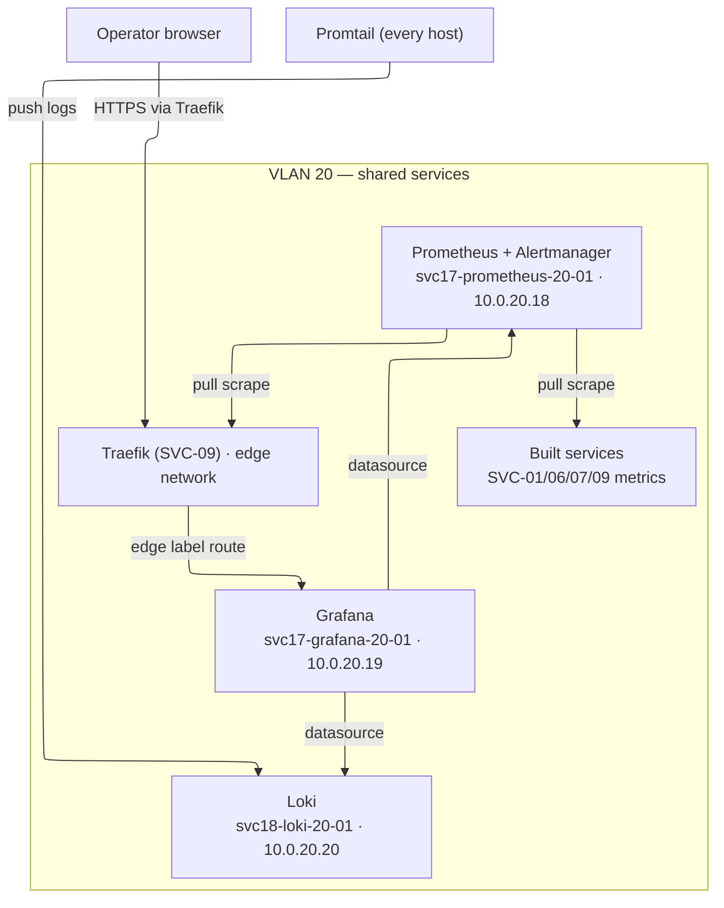

# SVC-17/18 Install Runbook — provision the observability stack from nothing, then run its live checks

This is the **provision-then-test spine** for SVC-17/18 (the platform
observability stack): it takes you from an empty throwaway Proxmox cluster to a
running three-LXC stack on VLAN 20 — **Prometheus + Alertmanager**, **Grafana**,
and **Loki** — and then verifies scraping, dashboards, logs, and the clean-slate
reset against the instances you just built. It is the "build the live thing, then
test what you built" half that the
[`../../../docs/TESTING.md`](../../../docs/TESTING.md) tier table assumes exists.

> To stand this service up as part of the whole platform (dependency-ordered, from
> an empty cluster), see the [all-services walkthrough](../../../docs/TESTING.md#deploy-every-implemented-service-from-scratch-all-services-walkthrough)
> in the testing guide.

There are **two paths**. Section **A** is the **Developer B** fast path: one
Ansible orchestrator command (`svc-17-18-bootstrap.yml`) that packages the whole
Day-0 bring-up — Preflight → Provisioning → Bootstrap → Handoff — for all three
guests, then health-gates what it built. Sections **0–4** are the **Developer A**
manual reference spine for diagnosing an individual phase or an individual guest.

It is deliberately **thin**: every step links into the existing SVC-17/18 docs
(the Terraform-root [`README.md`](./README.md), the `observability_stack` role,
and the mock catalogue in
[`mock-stand-ins.md`](../../../.kiro/steering/mock-stand-ins.md)) rather than
re-explaining them.

> **Placeholders only.** Every token, hostname, and domain here is a placeholder.
> The day-2 secrets the stack uses (the Grafana OIDC client secret, the
> Alertmanager SMTP/webhook credential, the Grafana break-glass admin password)
> are referenced **by name only** and come from OpenBao (SVC-07) at configure
> time — never committed or echoed (`documentation-testing.md`,
> `security-standards.md`). Substitute `<platform-domain>`,
> `<real-proxmox-lan-ip>`, and the container names for your deployment.

> **Doctest tiers.** Offline preflight commands carry `<!-- doctest: offline -->`;
> the `terraform apply`, the Ansible orchestrator runs, the health/scrape checks,
> and the teardown carry `<!-- doctest: requires-infra -->`. Tier rules are owned
> by [`documentation-testing.md`](../../../.kiro/steering/documentation-testing.md);
> the install-runbook location convention by
> [`structure.md`](../../../.kiro/steering/structure.md); the single-approved
> orchestrator + 4-phase contract by
> [`service-installer.md`](../../../.kiro/steering/service-installer.md); the
> live-run authorization by
> [`testing-strategy.md`](../../../.kiro/steering/testing-strategy.md).

---

## ⚠ Throwaway cluster only

The live steps provision, mutate, and tear down real infrastructure. Run them
**only against a throwaway / ephemeral Proxmox SDN test cluster** — never a shared
or production cluster. Section 4's teardown runs the service's clean-slate
contract, which destroys the three LXC guests (and, with them, the Prometheus
TSDB and Loki chunk/index volumes on their rootfs). Agent-driven live runs are
gated by the `AGENT_LIVE_AUTHORIZED` interlock + the fail-closed throwaway guard
(`testing-strategy.md` → "Agent Live-Test Authorization").

---

## Overview — the three-LXC stack

| Component | Guest hostname | VLAN-20 IP | What runs | Exposure |
|---|---|---|---|---|
| **Prometheus + Alertmanager** | `svc17-prometheus-20-01` | `10.0.20.18` (host_index 8) | metrics scrape, local TSDB (30d), alert routing | internal-only (`:9090`/`:9093`) |
| **Grafana** | `svc17-grafana-20-01` | `10.0.20.19` (host_index 9) | dashboards, Prometheus + Loki datasources | external via Traefik only |
| **Loki** | `svc18-loki-20-01` | `10.0.20.20` (host_index 10) | log aggregation (monolithic, 30d) | internal-only (`:3100`) |

Each guest is one unprivileged LXC running one Docker Compose stack, provisioned
by the single Terraform root `infra/projects/svc-17-18-observability/` (state
name `svc-17-18-observability`) and configured by the `observability_stack`
Ansible role. Fleet-wide exporters (node_exporter, cAdvisor, Promtail) feed it;
`dcgm-exporter` ships but is inert until a GPU host exists. Scrape targets are
**generated** from the Terraform-produced dynamic inventory
(`file_sd_configs` only) — the v1 target set is the four built services
SVC-01/06/07/09.



---

## Prerequisites

1. **Platform-foundation applied → `p20` bridge exists.** The three guests
   attach to the shared VLAN-20 VNet `p20`, created by the platform-foundation
   layer. Bring the platform prerequisites up first if `p20` does not exist (see
   the [platform install runbook](../../platform-foundation/INSTALL-RUNBOOK.md));
   the SVC-17/18 Preflight phase fails closed naming `p20` if it is absent.
2. **OpenBao / SVC-07 reachable** for the stack's day-2 secrets (Grafana OIDC
   client secret when enabled, Alertmanager notification credential, Grafana
   break-glass admin password). Secrets are read at configure time via the
   delegated `bao`-CLI docker-exec pattern (`no_log: true`), never templated from
   an Ansible variable (`integration-boundaries.md` §2).
3. **Traefik / SVC-09 running** — it owns the real `edge` Docker network and the
   file-provider default cert that Grafana's `websecure` route rides on
   (`mock-stand-ins.md`, SVC-09 ADR-0013). Prometheus/Loki/Alertmanager need no
   Traefik (internal-only).
4. **`cluster.env` authored** (or `cluster.dev.env` for the throwaway cluster)
   with the Proxmox endpoint/token/node, the three `*_template_file_id` /
   `*_datastore_id` / `*_vmid` values, and `platform_domain`. The automation
   phase reads **only** this file and fails closed at preflight on any missing
   variable (`service-installer.md` §2, ADR-0012).

---

## A. Developer-B automated path — one command, provision-then-test

Every command appears **exactly once**, in run order: offline preflight, then the
single-command install, then the health/scrape verification, then the clean-slate
reset.

### A.0 — Offline preflight (no cluster needed)

Validate the SVC-17/18 Terraform root the orchestrator's Provisioning phase
applies:

<!-- doctest: offline -->
<!-- cwd: infra/projects/svc-17-18-observability -->
```bash
terraform fmt -check -recursive
terraform init -backend=false
terraform validate
```

Parse-check the orchestrator playbook (compiles the play without connecting):

<!-- doctest: offline -->
<!-- cwd: . -->
```bash
~/venv/devinfra/bin/ansible-playbook --syntax-check \
  -i ansible/inventory/localhost.yml \
  ansible/playbooks/svc-17-18-bootstrap.yml
```

Lint the Prometheus/Alertmanager config, the alert rules, and render-check the
three Compose stacks. These are **not** committed static files: the configs are
Jinja templates (`ansible/roles/observability_stack/templates/*.j2`) and the
three Compose stacks are produced by the generic `docker-compose-app` role at
deploy time — there is no static `prometheus.yml`, `alert.rules.yml`, or
`*.compose.yml` to point `promtool`/`docker compose config` at offline. The
offline validation of the *rendered* configs is therefore the render suite
below: `test_obs_prometheus_render.py` renders `prometheus.yml.j2` /
`alertmanager.yml.j2` / the baseline rules from the role defaults and runs
`promtool check config` / `promtool check rules` against the rendered output via
the pinned `prom/prometheus` image when it is available (skipping that single
assertion with an explicit reason, never failing, when it is not), and
`test_obs_loki_render.py` does the same for `loki-config.yaml.j2`. Run the
SVC-17/18 offline suite (ledger guard, Terraform shape/plan, config render incl.
the `promtool` lint, scrape-target generation, mock drift-guards). The two
`pytest` roots run as **separate invocations** — their same-named `conftest.py`
collide if collected together (`testing-strategy.md` → "Offline gate"):

<!-- doctest: offline -->
<!-- cwd: . -->
```bash
~/venv/devinfra/bin/pytest \
  infra/tests/test_host_indices_obs.py \
  infra/tests/test_obs_terraform_shape.py \
  infra/tests/test_obs_offline_plan.py \
  infra/tests/test_obs_prometheus_render.py \
  infra/tests/test_obs_loki_render.py \
  infra/tests/test_obs_scrape_targets.py -q
~/venv/devinfra/bin/pytest tests/installer/test_obs_mocks.py -q
```

### A.1 — Prerequisite: the VLAN-20 fabric

The orchestrator's Preflight phase asserts `p20` exists and fails closed naming
it if absent — apply platform-foundation first (see Prerequisites above).

### A.2 — One-command install (provision → bootstrap → health)

On a throwaway cluster before SVC-08 (CA) and a Grafana OIDC client exist, enable
the TLS mock and leave OIDC/GPU at their defaults (the three mock flags and their
flip-to-real are documented in
[`mock-stand-ins.md`](../../../.kiro/steering/mock-stand-ins.md) — not restated
here):

<!-- doctest: requires-infra -->
<!-- cwd: . -->
```bash
~/venv/devinfra/bin/ansible-playbook -i ansible/inventory/localhost.yml \
  ansible/playbooks/svc-17-18-bootstrap.yml \
  -e cluster_env_file=cluster.dev.env \
  -e obs_tls_self_signed=true
```

The orchestrator runs **Preflight** (`cluster.env` resolve, Proxmox auth, `p20`
gate, datastore autodetect, `promtool`/local prereq checks), **Provisioning**
(`terraform apply` of the three LXC guests, inventory generation to
`ansible/inventory/svc-17-18-observability.generated.yml`, known_hosts refresh for
`.18`/`.19`/`.20`), **Bootstrap** (the `common` role on all three guests, then the
`observability_stack` role per guest + the fleet exporter roles, scrape-target
render, OpenBao secret reads), and **Handoff** (the `svc-17-18-health.yml` gate +
the completion banner showing `grafana.<platform-domain>`, the three internal
IPs, and the scrape-target up-count).

### A.3 — Verify scraping, logs, and dashboards (health)

The Handoff phase already ran `svc-17-18-health.yml` (each stack container Running
→ `/-/healthy` / `/api/health` / `/ready` per guest → the V1 scrape set reporting
`up == 1`). To re-run that gate standalone against the freshly-provisioned guests
(wiring the test target from the instance just built — the generated inventory):

<!-- doctest: requires-infra -->
<!-- cwd: . -->
```bash
~/venv/devinfra/bin/ansible-playbook \
  -i ansible/inventory/svc-17-18-observability.generated.yml \
  ansible/playbooks/svc-17-18-health.yml \
  -e obs_tls_self_signed=true
```

This confirms SVC-01 `postgres_exporter` (:9187), SVC-06 ZITADEL, SVC-07 OpenBao,
and SVC-09 Traefik (:8082) are `up == 1` via the generated `file_sd_configs`
(no manual `prometheus.yml` edit), node_exporter/cAdvisor are `up == 1`, Promtail
logs are queryable in Loki, and Grafana is reachable through Traefik under the
self-signed TLS mock (`validate_certs: false`, break-glass admin login).

### A.4 — Clean-slate reset

<!-- doctest: requires-infra -->
<!-- cwd: . -->
```bash
~/venv/devinfra/bin/ansible-playbook -i ansible/inventory/localhost.yml \
  ansible/playbooks/svc-17-18-bootstrap.yml \
  -e clean_slate=true -e clean_slate_confirm=force \
  -e cluster_env_file=cluster.dev.env
```

The reset pct-destroys **all three** guests and removes them from the single
`svc-17-18-observability` Terraform state, then verifies an empty baseline two
ways: `pct list` shows none of the three guests AND `terraform state list` is
EMPTY — zero surviving guests **and** zero non-guest `terraform_data` book-keeping
(the three-guests-one-state empty-baseline gate, `service-installer.md` §4,
requirements FR-18/AC-10). A surviving resource FAILS the gate rather than
reporting a false-clean.

---

## A.5 — Grafana reachable through Traefik (cross-guest file-provider route)

This is the provision-then-test step for the **cross-guest ingress** behavior
introduced by the
[`traefik-cross-guest-ingress`](../../../.kiro/specs/traefik-cross-guest-ingress/)
spec and recorded in
[`ADR-0018`](../../../.kiro/decisions/0018-traefik-cross-guest-ingress-via-file-provider-static-routes.md).
It closes the SVC-17/18 case that was BLOCKED cross-guest (Grafana runs on its
own guest `svc17-grafana-20-01` · `10.0.20.19`, Traefik on a **separate** guest
`svc09-20-01` · `10.0.20.12`, so a host-local `edge` Docker network can never
bridge them and Traefik never discovers Grafana's labels).

**How the real (default) path works.** The `observability_stack` Grafana role,
on the default production path (`obs_grafana_mock_edge=false`):

1. **Publishes Grafana's VLAN20_Port** — binds `3000` to the Grafana guest's
   **own VLAN-20 IP** (`10.0.20.19:3000`), never `0.0.0.0` and never a LAN port.
   Reachable only on VLAN 20, consumed only by Traefik — the same
   private-VLAN-bound-port exception the fleet exporters (`:9100`/`:8080`) and
   Loki (`:3100`) already use (ADR-0018).
2. **Delegates a Traefik file-provider Route_Fragment** (`grafana-route.yml`,
   one `http.routers` + one `http.services` entry pointing at
   `http://10.0.20.19:3000`) onto the Traefik_Guest's watched dynamic-config dir
   via the shared `traefik_route` role — the same `delegate_to` technique as the
   Mock-B self-signed cert. **No SVC-09 `traefik_install` edit**, no cross-guest
   `edge` network, no orchestrator/overlay.

Traefik then hot-reloads the fragment (watched file provider, no restart) and
proxies `https://grafana.<platform-domain>/` to the Grafana VLAN20_Port over
VLAN 20, terminating TLS at Traefik (the real resolver when a CA exists, or the
SVC-09 file-provider default cert from the self-signed Mock B otherwise).

> **Mock-edge is a dev/offline affordance only.** `obs_grafana_mock_edge=true`
> flips Grafana onto a **co-located-Traefik** path (attach the local
> `edge` network + emit Traefik discovery labels, **no** VLAN20_Port, **no**
> file-provider route). It is a permanent, default-off placeholder per
> [`mock-stand-ins.md`](../../../.kiro/steering/mock-stand-ins.md) and must
> **never** be enabled on a host where SVC-09 owns the real `edge` (ADR-0013).
> The real cross-guest route above is the default production posture.

### A.5.0 — Offline preflight (render the route, no cluster needed)

Render-check the Grafana Route_Fragment + the `traefik_route` delegate/swap-gate
and the Grafana VLAN20_Port binding. These run offline against the role
templates/tasks (no Traefik, no cluster). Run from the `tests/installer` pytest
root as its own invocation (its `conftest.py` collides with the `infra/tests`
root if collected together — `testing-strategy.md` → "Offline gate"):

<!-- doctest: offline -->
<!-- cwd: . -->
```bash
~/venv/devinfra/bin/pytest \
  tests/installer/test_traefik_route.py \
  tests/installer/test_traefik_route_idempotency.py -q
```

Compile-check the orchestrator play that drives the delegating role (no connect):

<!-- doctest: offline -->
<!-- cwd: . -->
```bash
~/venv/devinfra/bin/ansible-playbook --syntax-check \
  -i ansible/inventory/localhost.yml \
  ansible/playbooks/svc-17-18-bootstrap.yml
```

### A.5.1 — Live check: Grafana through Traefik (requires-infra)

After the A.2 bring-up has run (Grafana publishing `10.0.20.19:3000` and its
`grafana-route.yml` delegated onto the Traefik_Guest), confirm the cross-guest
route end-to-end: a LAN request through Traefik returns Grafana's login page
(HTTP 200), TLS terminated at Traefik, proxied to the VLAN20_Port over VLAN 20.
`-k` tolerates the self-signed Mock-B cert when no real CA is present. Substitute
`<platform-domain>` for your deployment's base domain:

<!-- doctest: requires-infra -->
<!-- cwd: . -->
```bash
curl -k -sS -o /dev/null -w '%{http_code}\n' https://grafana.<platform-domain>/
```

A `200` proves discovery is solved via the file provider (not a host-local
`edge`): Traefik learned the `grafana.<platform-domain> → 10.0.20.19:3000`
mapping from the delegated Route_Fragment and reached the backend over VLAN 20.
A re-run of the A.2 bring-up is idempotent for the route (`changed=0` — the
byte-identical fragment is not re-written); the A.4 clean-slate removes the
delegated `grafana-route.yml` from the Traefik_Guest so a torn-down Grafana
leaves no dangling route.

---

## 0–4. Developer-A manual reference spine

- **0. Fabric gate.** Confirm `p20` exists (`pvesh get /cluster/sdn/vnets`); if
  absent, apply platform-foundation first. All three guest NICs attach to `p20`
  (`terraform@pve` needs `SDN.Use` to attach them — granted per ADR-0009).
- **1. Provision.** `terraform apply` the one SVC-17/18 root — three LXC guests
  via three `proxmox-compute` module blocks at host indices 8/9/10 →
  `10.0.20.18`/`.19`/`.20`, read from the Host_Index_Authority ledger
  `infra/platform-foundation/host-indices.yaml`. Each block passes the other two
  indices as `peer_host_indices`, feeding the module's plan-time precondition
  that fails CLOSED on any within-VLAN collision before a resource is created.
- **2. Configure.** The `common` role installs Docker + Compose on each guest;
  `observability_stack` renders, per guest, `prometheus.yml` (file_sd only) +
  `alertmanager.yml` + baseline rules, the Grafana provisioning YAML +
  `edge`-network Traefik labels, and `loki-config.yaml`; then brings up each
  Compose stack (content-hash guarded).
- **3. Scrape targets.** Prometheus discovers targets ONLY via `file_sd_configs`;
  the target files are generated from the generated inventory with
  `project`/`service` labels — a built service not yet present simply yields no
  target file (degrade, not fail).
- **4. Health.** `svc-17-18-health.yml` gates per guest on the container being
  Running, the health endpoint answering, and the V1 scrape set reporting
  `up == 1`. Under the TLS mock the Grafana-via-Traefik check uses
  `validate_certs: false`; the internal `/api/health` on the guest is plain.

---

## Mock stand-ins (permanent, default-off)

SVC-17/18 ships three permanent, default-off/deferred mock stand-ins for
dependencies that are not yet built or registered. Their flags, defaults,
fail-closed behavior, and exact flip-to-real triggers are catalogued in
[`mock-stand-ins.md`](../../../.kiro/steering/mock-stand-ins.md) (Mocks A/B/C) —
**not restated here**. In short:

| Flag (default) | Stands in for | Flip to real |
|---|---|---|
| `grafana_oidc_enabled` (false) | SVC-06 Grafana OIDC client (un-registered) | register the client in ZITADEL + store its secret in OpenBao, then `-e grafana_oidc_enabled=true` |
| `obs_tls_self_signed` (false) | SVC-08 CA / Let's Encrypt (not built) | deploy SVC-08 (or reach Let's Encrypt) — leave the flag false; Traefik's real resolver issues the Grafana cert |
| `dcgm_metrics_deferred` (true) | SVC-23 GPU host (not built) | a `gpu`-tagged host exists, then `-e dcgm_metrics_deferred=false` |

The default-off/`deferred` posture IS the real-vs-mock swap gate: it defaults to
the production (real) posture where the dependency exists and falls back to an
honest/inert stand-in (never canned success) where it does not. With a mock off
and its real dependency absent, config render **fails closed** with a remedy —
it never silently serves no TLS nor leaves Grafana anonymous.

---

## Destructive-plan guardrail

The Prometheus and Loki guests carry a `prevent_destroy` lifecycle seatbelt
(stateful TSDB + Loki chunk/index volumes on their rootfs); Grafana is
config-as-code (dashboards are version-controlled JSON) so it does not. A
`terraform apply` that would **replace** the Prometheus or Loki guest in place
hard-errors on the seatbelt rather than silently discarding its data store —
relocating or rebuilding either guest is a conscious one-time re-provision via
this service's own clean-slate contract (Section A.4), never an incidental
in-place replace. The TSDB/chunks are re-scrapeable/re-shippable from live
sources, but the seatbelt makes the destruction deliberate, not accidental.

---

## See also (steering — authoritative, not restated here)

- [`service-installer.md`](../../../.kiro/steering/service-installer.md) — the
  single-approved Ansible orchestrator + the mandatory 4-phase installer contract
  + the clean-slate reset contract.
- [`testing-strategy.md`](../../../.kiro/steering/testing-strategy.md) — the
  offline-gate conventions (two separate `pytest` roots), the shared-symbol
  full-suite rule, and the Agent Live-Test Authorization interlock for the
  `requires-infra` steps above.
- [`mock-stand-ins.md`](../../../.kiro/steering/mock-stand-ins.md) — the three
  mock flags, their fail-closed semantics, and their flip-to-real triggers.
- [`structure.md`](../../../.kiro/steering/structure.md) — the install-runbook
  location convention and the README implemented-services-index rule.
- [`README.md`](./README.md) — the Terraform-root reference for this service's
  three guests, variables, and outputs.
